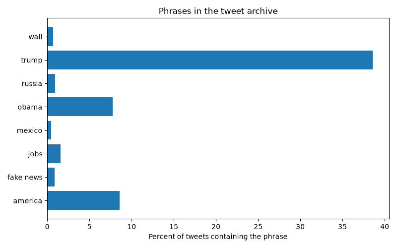

# [lab-web-data](https://csci40.rtealwitter.com/topics/05_web_scraping/lab.html)

| phrase            | percent of tweets |
| ----------------- | ----------------- |
|           america | 08.58             |
|         fake news | 00.88             |
|              jobs | 01.59             |
|            mexico | 00.45             |
|             obama | 07.73             |
|            russia | 00.91             |
|             trump | 38.58             |
|              wall | 00.68             |

I predicted that `america` would be the most common of my chosen phrases. The chart shows that [what actually happened, and whether you were right].